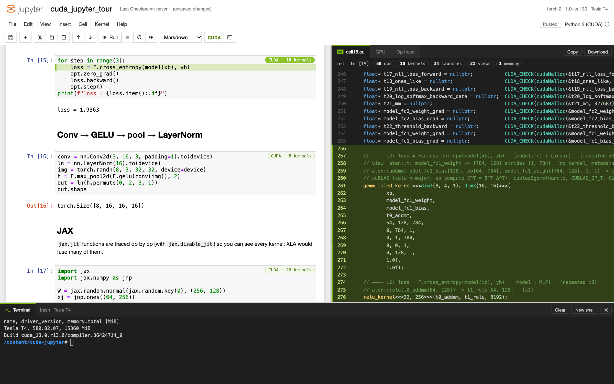
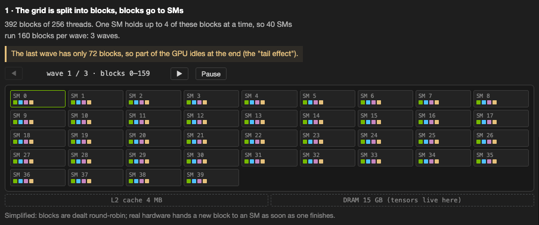
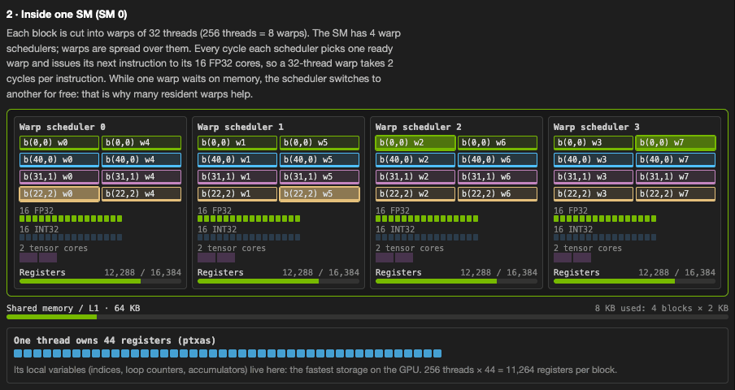
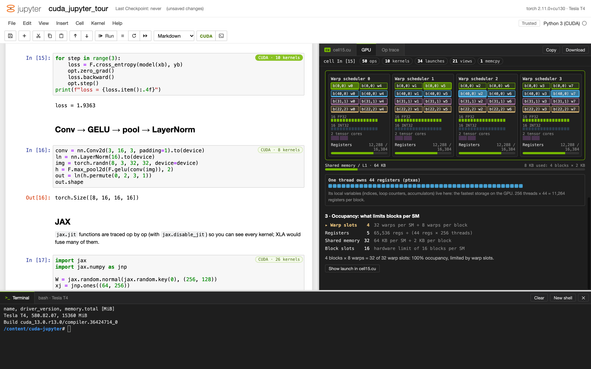
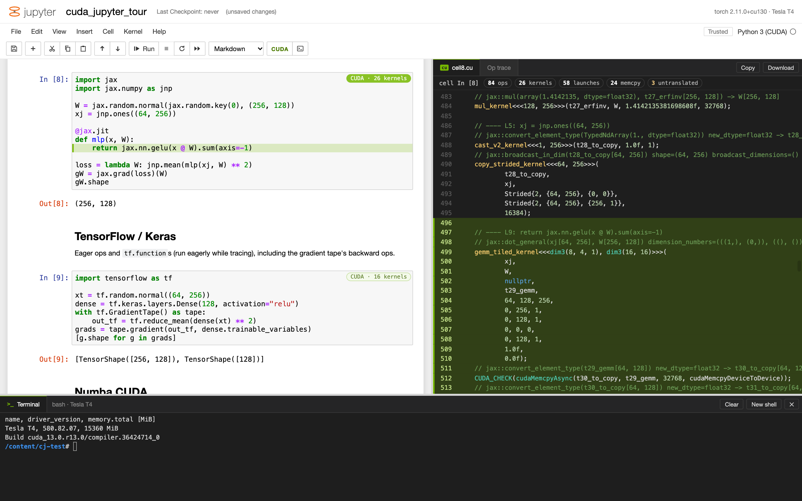
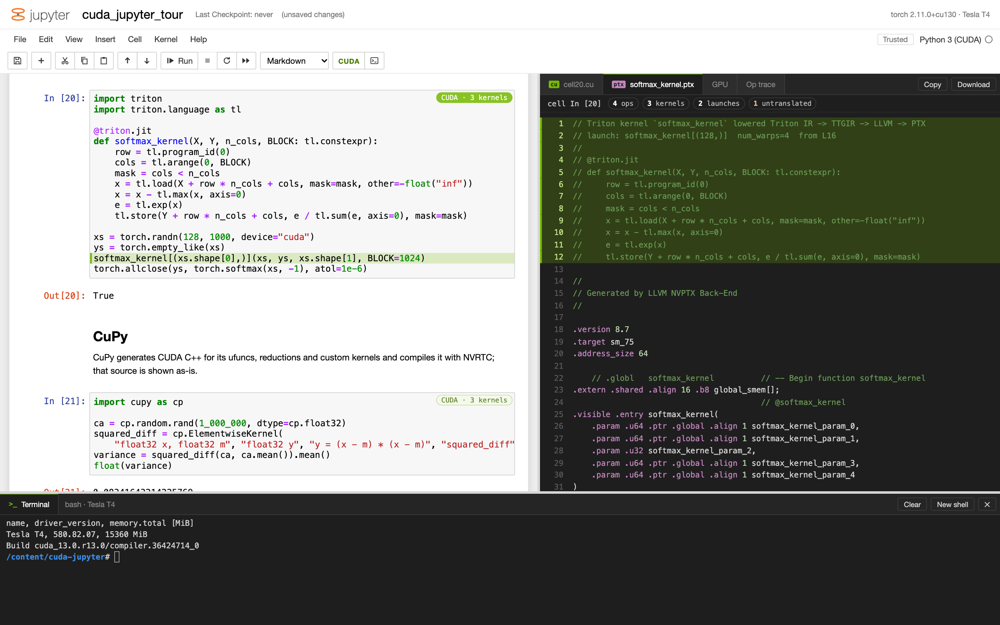
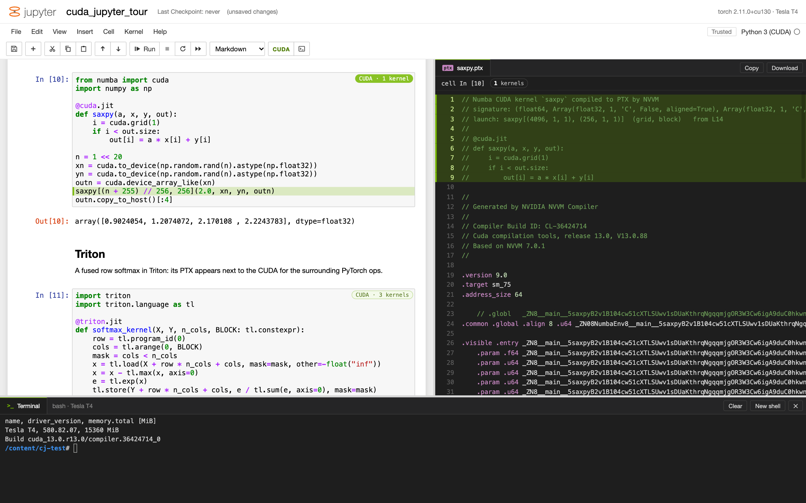
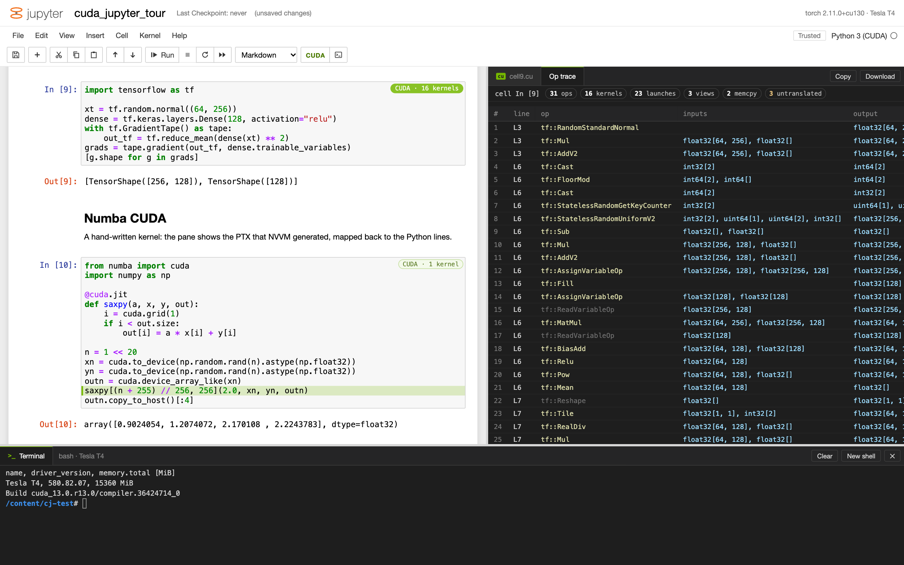
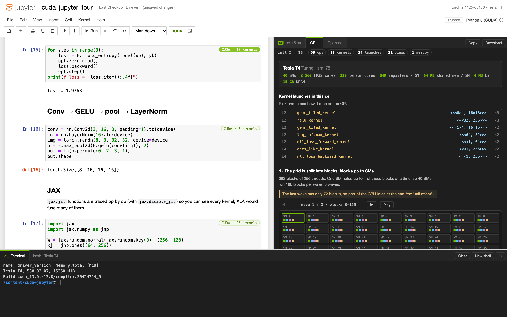

# cuda-jupyter

**A Jupyter-style notebook that shows you the CUDA behind every cell, and what the GPU does with it.**

Write PyTorch, JAX or TensorFlow as usual. When a cell runs, the pane on the right fills in with the CUDA C++ that
cell corresponds to: the kernels, launch configurations, `cudaMalloc`s and copies, for the exact shapes, dtypes and
strides it used. Write a Numba, Triton or CuPy kernel and you see the real PTX or CUDA source its compiler produced.
The **GPU** tab then plays the launch out on the actual device: blocks dealt to SMs in waves, warps on the
schedulers, cores, registers and shared memory. A terminal underneath lets you `nvcc` the generated file straight
away.



## Watch a kernel run on the GPU

Pick any launch in the GPU tab and press **Play**.

**1. The grid is split into blocks, and blocks go to SMs.** Each tile is one SM on the device and each square is a
block resident on it. Waves advance until the grid is done. Small launches that leave SMs idle, and a short last wave
(the tail effect), stand out immediately.



**2. Inside one SM.** Each block is cut into warps of 32 threads and spread over the SM's warp schedulers. Every
cycle, each scheduler picks a ready warp (highlighted) and issues its next instruction to its FP32 cores. Bars show how
much of the register file and shared memory the resident blocks use, and a row of cells shows the registers one
thread owns.



**3. Occupancy.** How many blocks fit on an SM at once, limited by warp slots, registers, shared memory or block
slots, with the binding limit highlighted.



The numbers come from the real device (`torch.cuda.get_device_properties` plus a per-architecture table covering
Pascal to Blackwell) and the real kernels: register counts are reported by `ptxas` (compiled on demand with
`nvcc --resource-usage`), by Numba or by Triton. With no GPU, a Tesla T4 is shown and register counts are estimated.

## Every framework

| Framework | What the CUDA pane shows |
|---|---|
| PyTorch | `cellN.cu` translated from the ATen ops: forward, autograd backward, optimizer steps |
| JAX | `cellN.cu` translated from the `jax.lax` primitives (`jax.jit` functions are traced op by op) |
| TensorFlow / Keras | `cellN.cu` translated from the eager TF ops (`tf.function` runs eagerly while tracing) |
| Numba (`@cuda.jit`) | the PTX Numba compiled, with the kernel's Python source as a header |
| Triton (`@triton.jit`) | the PTX Triton compiled, mapped back to the kernel's Python lines |
| CuPy | the CUDA C++ CuPy generated for its kernels (`ElementwiseKernel`, ufuncs, reductions, ...) |

| JAX | Triton |
|---|---|
|  |  |

| Numba | TensorFlow op trace |
|---|---|
|  |  |

## Features

- **Notebook** (left): classic Jupyter look and keyboard model (Shift+Enter, A/B, D,D, M/Y, Esc/Enter, Ctrl+S), code
  and Markdown cells, saved as `notebook.ipynb`.
- **CUDA pane** (right): one tab per generated file (`cellN.cu`, `*.ptx`, `*.cu`), plus the **GPU** tab and an
  **Op trace** tab listing every recorded op. Hover a CUDA line to highlight the Python line that produced it; click
  to jump there. Moving the cursor in a cell highlights its CUDA. Copy or download any file.
- **Terminal** (bottom): a real shell (`$SHELL`) with the virtualenv and `nvcc` on `PATH`.
- **Long-running cells** show a live timer; cells run as server-side jobs, so a slow cell or a dropped connection
  doesn't lose the result.



## Quick start

### Locally

```sh
./run.sh          # first run creates .venv (uv, Python 3.13) and installs requirements.txt
# open http://127.0.0.1:8888
```

No GPU needed: cells run on CPU and the CUDA is still generated (the GPU tab shows a Tesla T4). Only PyTorch is
installed by default; `pip install jax tensorflow` into `.venv` to try those. Numba, Triton and CuPy need an NVIDIA
GPU. The first launch opens `examples/cuda_jupyter_tour.ipynb`, a tour of every framework.

### On a free Colab T4

```sh
./run_t4          # opens http://localhost:8888, served from a Colab T4
```

Requires the `colab` CLI (`uv tool install google-colab-cli`) and an SSH key it can use. The script connects to the
Colab session `t4` (creating it with a T4 if needed), uploads the project to `/content/cuda-jupyter`, starts the server
and forwards it to localhost. Cells then run on real CUDA, the GPU tab shows real `ptxas` register counts, and the
terminal is a bash shell on the VM where `nvcc -O3 -arch=sm_75 cellN.cu` builds the generated code. Colab images
already include PyTorch, JAX, TensorFlow, Numba, Triton and CuPy.

If the connection drops, `run_t4` reconnects (the server and kernel state survive on the VM). Ctrl-C stops the remote
server and copies `notebook.ipynb` back.

Options: `SESSION=`, `GPU=`, `KEY=`, `LOCAL_PORT=`, `REMOTE_PORT=`, `REMOTE_DIR=`, `NO_OPEN=1`. Colab allows one SSH
connection per runtime, so `colab ssh` to the same session can't connect while `run_t4` runs; use the in-page
terminal instead.

### Just a Colab GPU shell

`colab_t4` creates and uses the same Colab runtime without the notebook:

```sh
./colab_t4                # create the T4 runtime if needed and open a shell in /content
./colab_t4 ssh nvidia-smi # run a command on it
./colab_t4 new            # create it and print its GPU
./colab_t4 status         # session status and compute-unit balance
./colab_t4 stop           # stop the runtime (asks first)
```

It shares `run_t4`'s SSH connection, so both work at the same time. `GPU=L4`, `GPU=A100` etc. pick another
accelerator, `GPU=none` a CPU runtime. If Colab has no GPU for the account (free quota used up), it says so instead of
hanging.

## How it works

| File | Role |
|---|---|
| `server.py` | FastAPI app: serves the UI, runs cells as jobs on a single worker (one kernel, cells in order), reports device limits, runs `nvcc --resource-usage` for register counts, and exposes a pty shell over a WebSocket |
| `engine.py` | runs each cell in a persistent namespace; PyTorch ops are recorded by a `TorchDispatchMode` (arguments, shapes, strides, storages, cell line, enclosing `nn.Module`, autograd node), and tensors are named after the Python variables, parameters and optimizer state that hold them |
| `frameworks.py` | hooks for the other frameworks, installed when they are imported: JAX `Primitive.bind` and TensorFlow op callbacks become the same op events as ATen; Numba, Triton and CuPy compile hooks capture the generated PTX/CUDA and launch configuration |
| `cudagen.py` | turns the op trace into a `.cu` file from hand-written templates, plus a structured record of every kernel launch |
| `static/gpu.js` | the GPU tab: wave scheduling, the SM view and the occupancy calculation (register allocation per warp, shared memory granularity, warp and block slots) |

Templates used by `cudagen.py`:

| Ops | CUDA |
|---|---|
| ~90 elementwise ops (+ backward formulas, optimizer updates) | one thread per element; strided/broadcast variant when needed |
| `mm`, `addmm`, `bmm`, `dot_general`, `MatMul`, ... | 16x16 shared-memory tiled GEMM (+ the equivalent `cublasSgemm` call) |
| `sum`, `mean`, `amax`, `argmax`, `reduce_*`, ... | per-output reduction or a single-block tree reduction |
| softmax / log_softmax (+ backward), layer norm | one block per row with warp-shuffle block reductions |
| `nll_loss`, `mse_loss`, convolution, pooling, embedding, concat | dedicated kernels |
| `randn`, `rand`, `randint`, dropout | cuRAND Philox kernels |
| views (`t`, `view`, `permute`, `reshape`, ...) | no kernel; pointer + strides |

Ops without a template are kept as commented calls. Repeated loop iterations are collapsed (with a count) and reuse the
first iteration's buffers. The generated files compile with `nvcc`.

## Limitations

- The `.cu` translation is illustrative. It shows what the GPU work for a cell looks like, not what the framework
  actually runs (cuBLAS/cuDNN, XLA fusions, vectorised kernels). Numerical equivalence is not guaranteed.
- The GPU tab is a model: blocks are dealt round-robin in fixed waves, while real hardware hands out blocks as
  others finish. CuPy launches are not shown there.
- JAX and TensorFlow are traced eagerly (`jax.disable_jit`, `tf.config.run_functions_eagerly`), so cells run slower
  and you see unfused ops.
- CuPy caches compiled kernels, so only kernels compiled during a cell are shown.
- No interrupt button (restart the server to stop a runaway cell); outputs are text only (no plots).

## License

MIT. Bundled front-end libraries in `static/vendor` (CodeMirror, highlight.js, marked, xterm.js) keep their own
MIT/BSD licenses.
