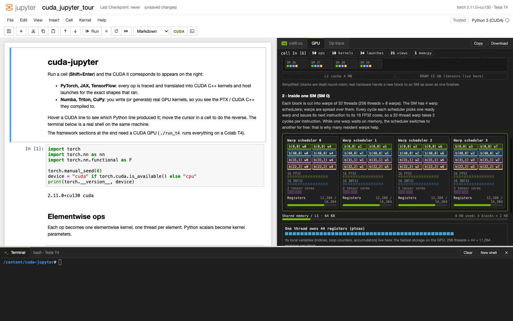

# cuda-jupyter

A Jupyter-style notebook that shows, next to every cell, the CUDA its Python code turns into.

Run a PyTorch, JAX or TensorFlow cell and a CUDA C++ file for that cell appears on the right: kernels, launch
configurations and host code for the exact shapes, dtypes and strides the cell used. Run a Numba, Triton or CuPy
kernel and you see the real PTX or CUDA source the compiler produced. A shell sits underneath, so you can `nvcc` the
generated file right away.


## Features

- **Notebook** (left): classic Jupyter look and keyboard model (Shift+Enter, A/B, D,D, M/Y, Esc/Enter, Ctrl+S).
  Code and Markdown cells, saved as `notebook.ipynb`.
- **CUDA pane** (right): appears after a cell runs, with one tab per generated file (`cellN.cu`, `*.ptx`, `*.cu`) and
  an *Op trace* tab listing every recorded op. Hover a CUDA line to highlight the Python line that produced it; click
  to jump there. Moving the cursor in a cell highlights its CUDA. Copy or download any file.
- **GPU tab**: what a kernel launch does on the actual device. The grid is dealt to the SMs in waves (idle SMs and
  tail effects show up), then one SM is opened up: warp schedulers with the resident warps of each block, FP32/INT32
  cores and tensor cores, register file and shared memory usage, the registers one thread owns, and an occupancy
  breakdown showing which resource limits blocks per SM. Register counts come from `ptxas` (via `nvcc`), Numba or
  Triton; without a GPU a Tesla T4 is shown with estimated counts.
- **Terminal** (bottom): a real shell (`$SHELL`), with the virtualenv and `nvcc` on `PATH`.

| Framework | What the pane shows |
|---|---|
| PyTorch | `cellN.cu` translated from the ATen ops (forward, autograd backward, optimizer steps) |
| JAX | `cellN.cu` translated from the `jax.lax` primitives (`jax.jit` functions are traced op by op) |
| TensorFlow / Keras | `cellN.cu` translated from the eager TF ops (`tf.function` runs eagerly while tracing) |
| Numba (`@cuda.jit`) | the PTX Numba compiled, with the kernel's Python source as a header |
| Triton (`@triton.jit`) | the PTX Triton compiled, mapped back to the kernel's Python lines |
| CuPy | the CUDA C++ CuPy generated for its kernels (`ElementwiseKernel`, ufuncs, reductions, ...) |

| JAX | Triton |
|---|---|
|  |  |

| Numba | TensorFlow op trace |
|---|---|
|  |  |



## Quick start

### Locally

```sh
./run.sh          # first run creates .venv (uv, Python 3.13) and installs requirements.txt
# open http://127.0.0.1:8888
```

Tracing works without a GPU (cells run on CPU and the CUDA is still generated). Only PyTorch is installed by default;
`pip install jax tensorflow` etc. into `.venv` to try the other frameworks. Numba, Triton and CuPy need an NVIDIA GPU.

The first launch opens `examples/cuda_jupyter_tour.ipynb`, a tour of every framework.

### On a Colab T4 GPU

```sh
./run_t4          # opens http://localhost:8888, served from a Colab T4
```

Requires the [`colab` CLI](https://pypi.org/project/google-colab-cli/) and an SSH key it can use. The script connects
to the Colab session `t4` (creating it with a T4 if needed), uploads the project to `/content/cuda-jupyter`, starts the
server and forwards it to localhost. Cells then run on real CUDA, and the terminal is a bash shell on the VM where
`nvcc -O3 -arch=sm_75 cellN.cu` builds the generated code. Colab images already include PyTorch, JAX, TensorFlow,
Numba, Triton and CuPy.

If the connection drops, `run_t4` reconnects (the server and kernel state survive on the VM). Ctrl-C stops the remote
server and copies `notebook.ipynb` back.

Options: `SESSION=`, `GPU=`, `KEY=`, `LOCAL_PORT=`, `REMOTE_PORT=`, `REMOTE_DIR=`, `NO_OPEN=1`.
Colab allows one SSH connection per runtime, so `colab ssh` to the same session can't connect while `run_t4` runs;
use the in-page terminal instead.

## How it works

- `server.py`: FastAPI app. Serves the UI, runs cells as jobs on a single worker (one kernel, cells in order; the
  browser long-polls for results and retries across dropped connections), and exposes a pty shell over a WebSocket.
- `engine.py`: runs each cell in a persistent namespace. PyTorch ops are recorded by a `TorchDispatchMode` (arguments,
  shapes, strides, storages, cell line, enclosing `nn.Module`, autograd node). Tensors are named after the Python
  variables, module parameters and optimizer state that hold them.
- `frameworks.py`: hooks for the other frameworks, installed when they are imported. JAX `Primitive.bind` and
  TensorFlow op callbacks are mapped onto the same op events as ATen; Numba, Triton and CuPy compile hooks capture
  the generated PTX/CUDA and map it back to cell lines via debug info.
- `static/gpu.js`: the GPU tab. Device limits come from `torch.cuda.get_device_properties` plus a per-architecture
  table (cores and schedulers per SM); occupancy follows NVIDIA's calculator (register allocation per warp, shared
  memory granularity, block and warp slots).
- `cudagen.py`: turns the op trace into a `.cu` file from hand-written templates:

| Ops | CUDA |
|---|---|
| ~90 elementwise ops (+ backward formulas, optimizer updates) | one thread per element; strided/broadcast variant when needed |
| `mm`, `addmm`, `bmm`, `dot_general`, `MatMul`, ... | 16x16 shared-memory tiled GEMM (+ the equivalent `cublasSgemm` call) |
| `sum`, `mean`, `amax`, `argmax`, `reduce_*`, ... | per-output reduction or a single-block tree reduction |
| softmax / log_softmax (+ backward), layer norm | one block per row with warp-shuffle block reductions |
| `nll_loss`, `mse_loss`, convolution, pooling, embedding, concat | dedicated kernels |
| `randn`, `rand`, `randint`, dropout | cuRAND Philox kernels |
| views (`t`, `view`, `permute`, `reshape`, ...) | no kernel; pointer + strides |

Ops without a template are kept as commented calls. Repeated loop iterations are collapsed (with a count) and reuse the
first iteration's buffers. The generated files compile with `nvcc`.

## Limitations

- The `.cu` translation is illustrative. It shows what the GPU work for a cell looks like, not what the framework
  actually runs (cuBLAS/cuDNN, XLA fusions, vectorised kernels). Numerical equivalence is not guaranteed.
- JAX and TensorFlow are traced eagerly (`jax.disable_jit`, `tf.config.run_functions_eagerly`), so cells run slower
  and you see unfused ops.
- The GPU tab is a model: blocks are dealt round-robin in fixed waves, while real hardware schedules blocks
  dynamically. CuPy launches are not shown there.
- CuPy caches compiled kernels, so only kernels compiled during a cell are shown.
- No interrupt button (restart the server to stop a runaway cell); outputs are text only (no plots).

## License

MIT. Bundled front-end libraries in `static/vendor` (CodeMirror, highlight.js, marked, xterm.js) keep their own
MIT/BSD licenses.
